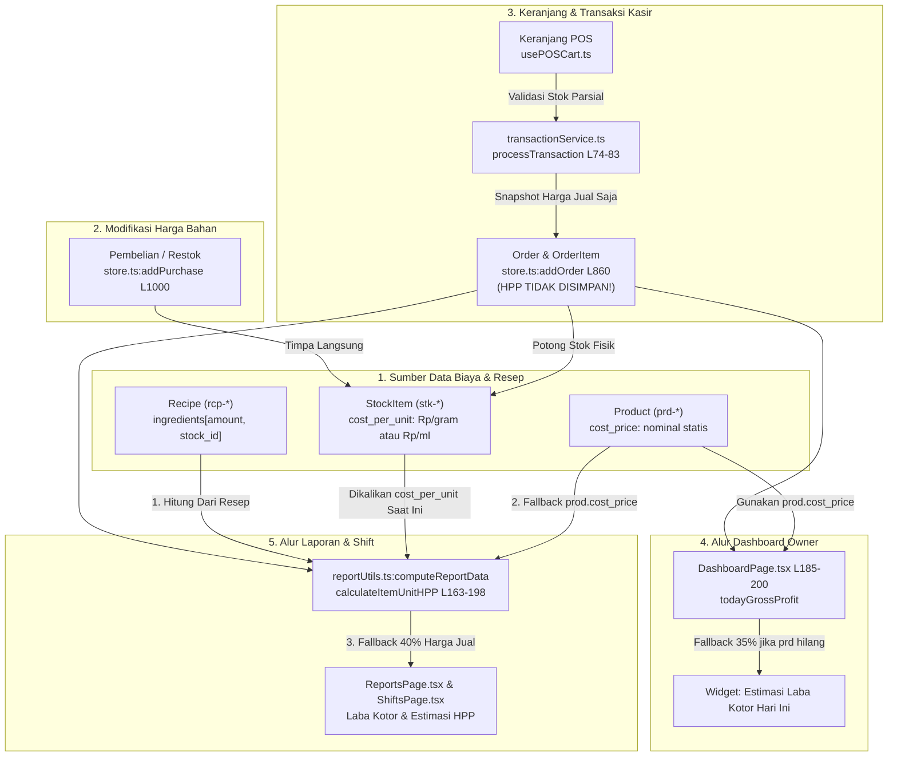

# LAPORAN AUDIT FASE 1: HPP, LABA KOTOR, DAN SNAPSHOT TRANSAKSI
**Aplikasi:** Booth Daily (Point of Sale & Booth Coffee Management)  
**Workspace:** `D:\project\Booth-Daily-demo`  
**Tanggal Audit:** 12 Oktober 2026  
**Status Audit:** READ-ONLY (Tanpa modifikasi kode aplikasi atau manipulasi data aktif)  
**Lingkungan Evaluasi:** TypeScript 5.8 Strict + Vite 6 + Node.js 24 Test Runner Terisolasi  

---

## 1. RINGKASAN EKSEKUTIF

Audit Fase 1 berfokus secara mendalam pada integritas finansial aplikasi Booth Daily, mencakup perhitungan **Harga Pokok Penjualan (HPP)**, **Laba Kotor (Gross Profit)**, dan mekanisme penyimpanan **Snapshot Transaksi Historis**.

Berdasarkan penelusuran kode sumber, audit repositori, dan eksekusi 10 skenario pengujian empiris terisolasi, ditemukan beberapa masalah struktural mendasar:

1. **Disparitas Formula HPP Antar-Halaman:**  
   [DashboardPage.tsx](file:///d:/project/Booth-Daily-demo/src/pages/DashboardPage.tsx#L186-L200) menghitung laba kotor menggunakan nilai statis `product.cost_price` atau estimasi flat 35% tanpa membaca resep dan harga bahan baku. Sebaliknya, [reportUtils.ts](file:///d:/project/Booth-Daily-demo/src/utils/reportUtils.ts#L163-L198) (yang digunakan oleh Halaman Laporan dan Shift) menghitung HPP secara dinamis dari resep bahan baku dikalikan harga modal bahan per satuan (`cost_per_unit`). Akibatnya, angka Laba Kotor pada Dashboard dan Laporan Keuangan tidak pernah cocok.
2. **Ketiadaan Snapshot Biaya Pokok Pada Transaksi (`OrderItem`):**  
   Entitas `OrderItem` ([src/types/index.ts:L105-L113](file:///d:/project/Booth-Daily-demo/src/types/index.ts#L105-L113)) hanya menyimpan `price`, `qty`, dan `subtotal` (harga jual). HPP unit saat transaksi terjadi **tidak disimpan sama sekali**.
3. **Distorsi Retroaktif Akibat Pembelian Restok:**  
   Ketika Owner mencatat pembelian bahan baku baru di [store.ts:L1000](file:///d:/project/Booth-Daily-demo/src/mock/store.ts#L1000), sistem langsung menimpa `stock.cost_per_unit`. Karena Halaman Laporan menghitung ulang HPP secara *on-the-fly* dari tabel bahan terkini, kenaikan harga bahan hari ini **mengubah nilai HPP dan Laba Kotor seluruh transaksi masa lalu secara retroaktif**.
4. **Anomali Pencatatan Refund Lintas Shift/Tanggal:**  
   Jika transaksi tanggal 1 direfund pada tanggal 2, uang kas fisik keluar dari laci shift tanggal 2 (`cash_refunds`), namun Laporan Keuangan tanggal 2 tidak mencatat transaksi refund tersebut (karena pesanan aslinya berstatus `created_at` tanggal 1). Sebaliknya, Laporan Keuangan tanggal 1 berkurang omzetnya secara retroaktif.

---

## 2. PETA ALUR PERHITUNGAN HPP AKTUAL

Berikut adalah diagram pemetaan alur HPP dari sumber modal bahan hingga penyajian laporan:



### Detail File dan Fungsi Terkait:

| Tahap | File & Fungsi | Peran & Logika Aktual |
| :--- | :--- | :--- |
| **Harga Bahan** | [src/mock/data/stocks.ts](file:///d:/project/Booth-Daily-demo/src/mock/data/stocks.ts#L10) | Menyimpan modal per unit (`cost_per_unit`) dalam satuan terkecil (Gram, ml). Contoh: Biji Kopi Rp 200/g, Fresh Milk Rp 25/ml, Gula Aren Rp 40/ml. |
| **Harga Beli Baru** | [src/mock/store.ts:L984-L1017](file:///d:/project/Booth-Daily-demo/src/mock/store.ts#L984-L1017) (`addPurchase`) | Pada baris 1000: `this.state.stocks[stockIndex].cost_per_unit = item.unit_cost`. Nilai biaya modal unit langsung ditimpa tanpa metode rata-rata tertimbang (Weighted Average) atau FIFO. |
| **Resep Menu** | [src/mock/data/recipes.ts](file:///d:/project/Booth-Daily-demo/src/mock/data/recipes.ts#L11-L40) | Memetakan kebutuhan bahan: `amount` dan `stock_id`. Contoh: Kopi Susu Gula Aren butuh 18g Kopi + 120ml Susu + 25ml Aren + 15g SKM. |
| **Pembuatan Transaksi** | [src/services/transactionService.ts:L74-L83](file:///d:/project/Booth-Daily-demo/src/services/transactionService.ts#L74-L83) | Membentuk `OrderItem[]`. Hanya menyalin `product_id`, `product_name`, `price`, `qty`, dan `subtotal`. **Field HPP unit atau subtotal modal tidak ada.** |
| **Simpan Pesanan & Stok** | [src/mock/store.ts:L790-L895](file:///d:/project/Booth-Daily-demo/src/mock/store.ts#L790-L895) (`addOrder`) | Memeriksa stok bahan baku berdasarkan resep gabungan dan memotong `current_amount` secara atomik, namun tidak mencatat HPP transaksi ke dalam objek `Order`. |
| **Perhitungan Dashboard** | [src/pages/DashboardPage.tsx:L185-L200](file:///d:/project/Booth-Daily-demo/src/pages/DashboardPage.tsx#L185-L200) | Menghitung `todayGrossProfit` dengan mengalikan `prod.cost_price` (atau fallback 35% jika produk tidak ditemukan). Resep dan stok **sama sekali diabaikan**. |
| **Perhitungan Laporan** | [src/utils/reportUtils.ts:L163-L262](file:///d:/project/Booth-Daily-demo/src/utils/reportUtils.ts#L163-L262) (`computeReportData`) | Memanggil `calculateItemUnitHPP`: Prioritas 1 Resep + Bahan, Prioritas 2 `prod.cost_price`, Prioritas 3 fallback 40%. Mengalikan secara dinamis dengan transaksi yang difilter. |
| **Perhitungan Shift** | [src/utils/shiftCalculation.ts:L124-L142](file:///d:/project/Booth-Daily-demo/src/utils/shiftCalculation.ts#L124-L142) | Menggunakan `calculateItemUnitHPP` dari `reportUtils.ts` untuk pesanan dalam shift dan membekukannya ke dalam `shift.snapshot` saat tutup shift. |

---

## 3. DAFTAR TEMUAN AUDIT MENDALAM

### HPP-01: Disparitas Formula HPP antara Dashboard vs Laporan & Shift
- **Kategori:** Logika Bisnis & Integritas Finansial
- **Prioritas:** **P1 (Kritis)**
- **Status:** **Terbukti (Verified)**
- **Lokasi Kode:**
  - [DashboardPage.tsx:L186-L200](file:///d:/project/Booth-Daily-demo/src/pages/DashboardPage.tsx#L186-L200)
  - [reportUtils.ts:L163-L198](file:///d:/project/Booth-Daily-demo/src/utils/reportUtils.ts#L163-L198)
- **Bukti Kode Aktual:**
  *Di `DashboardPage.tsx`:*
  ```ts
  const todayGrossProfit = useMemo(() => {
    const todayTotalCost = todayAllOrders.reduce((sum, order) => {
      const orderCost = (order.items || []).reduce((itemSum, item) => {
        const prod = products.find(p => p.id === item.product_id);
        const unitCost = prod
          ? Number(prod.cost_price || 0)
          : Number(item.price || 0) * 0.35;
        return itemSum + unitCost * item.qty;
      }, 0);
      return sum + orderCost;
    }, 0);
    return todayRevenue - todayTotalCost;
  }, [todayAllOrders, todayRevenue, products]);
  ```
  *Di `reportUtils.ts`:*
  ```ts
  export function calculateItemUnitHPP(productId, sellingPrice, products, recipes, stocks) {
    const recipe = recipes.find(r => String(r.product_id) === String(productId));
    if (recipe && recipe.ingredients && recipe.ingredients.length > 0) {
      let recipeCost = 0;
      for (const ing of recipe.ingredients) {
        const stockItem = stocks.find(s => String(s.id) === String(ing.stock_id));
        if (stockItem && stockItem.cost_per_unit > 0) {
          recipeCost += ing.amount * stockItem.cost_per_unit;
        }
      }
      if (recipeCost > 0) return { unitCost: recipeCost, isEstimatedFallback: false };
    }
    const prd = products.find(p => String(p.id) === String(productId));
    if (prd && prd.cost_price > 0) return { unitCost: prd.cost_price, isEstimatedFallback: false };
    return { unitCost: sellingPrice * 0.4, isEstimatedFallback: true };
  }
  ```
- **Dampak Nyata:**
  Pada produk terlaris "Kopi Susu Gula Aren":
  - Resep bahan baku = 18g kopi (Rp 3.600) + 120ml susu (Rp 3.000) + 25ml aren (Rp 1.000) + 15g SKM (Rp 450) = **Rp 8.050**.
  - Nilai `prod.cost_price` = **Rp 7.500**.
  - Dashboard menghitung HPP Rp 7.500, sedangkan Laporan menghitung HPP Rp 8.050.
  - Terdapat selisih **Rp 550 per cup**. Jika terjual 200 cup/hari, Laba Kotor di Dashboard lebih tinggi **Rp 110.000/hari** dibanding Laporan. Owner mengalami kebingungan karena dua halaman resmi menampilkan data yang saling bertentangan.

---

### HPP-02: Ketiadaan Snapshot Biaya Pokok Pada Transaksi (`OrderItem`)
- **Kategori:** Integritas Data & Desain Skema
- **Prioritas:** **P1 (Kritis)**
- **Status:** **Terbukti (Verified)**
- **Lokasi Kode:** [src/types/index.ts:L105-L113](file:///d:/project/Booth-Daily-demo/src/types/index.ts#L105-L113), [src/services/transactionService.ts:L74-L83](file:///d:/project/Booth-Daily-demo/src/services/transactionService.ts#L74-L83)
- **Bukti Kode Aktual:**
  ```ts
  export interface OrderItem {
    id: string;
    product_id: string;
    product_name: string;
    price: number;
    qty: number;
    notes?: string;
    subtotal: number;
  }
  ```
- **Dampak Nyata:**
  Ketika pesanan selesai, transaksi hanya membekukan harga jual (`price`). Biaya modal (`cost`) tidak disimpan. Halaman Laporan terpaksa menghitung ulang HPP secara dinamis terhadap master resep dan harga bahan yang aktif saat laporan dibuka.

---

### HPP-03: Timpaan Harga Beli Stok Merusak Laporan Historis Secara Retroaktif
- **Kategori:** Integritas Finansial & Akuntansi
- **Prioritas:** **P1 (Kritis)**
- **Status:** **Terbukti (Verified)**
- **Lokasi Kode:** [src/mock/store.ts:L1000](file:///d:/project/Booth-Daily-demo/src/mock/store.ts#L1000)
- **Bukti Kode Aktual:**
  ```ts
  if (item.unit_cost > 0) {
    this.state.stocks[stockIndex].cost_per_unit = item.unit_cost;
  }
  ```
- **Dampak Nyata:**
  Berdasarkan pengujian Skenario 4:
  1. Transaksi Kopi Susu pada 1 April 2026 dihitung dengan HPP Rp 8.050 (biji kopi Rp 200/g). Laba = Rp 13.950.
  2. Pada 12 Oktober 2026, Owner mencatat pembelian biji kopi baru dengan harga Rp 300/g.
  3. Saat laporan bulan April 2026 dibuka kembali, HPP transaksi 1 April 2026 **berubah menjadi Rp 9.850**, dan Laba Kotor turun menjadi Rp 12.150 (**rugi semu Rp 1.800 per cup**).
  4. Laporan keuangan masa lalu yang sudah ditutup dan diaudit menjadi tidak valid dan berubah-ubah secara liar mengikuti fluktuasi harga belanja terbaru.

---

### HPP-04: Mismatch Penanganan Refund Lintas Shift/Tanggal
- **Kategori:** Alur Operasional & Konsistensi Kasir
- **Prioritas:** **P1 (Kritis)**
- **Status:** **Terbukti (Verified)**
- **Lokasi Kode:** [src/utils/reportUtils.ts:L226-L227](file:///d:/project/Booth-Daily-demo/src/utils/reportUtils.ts#L226-L227), [src/utils/shiftCalculation.ts:L77-L82](file:///d:/project/Booth-Daily-demo/src/utils/shiftCalculation.ts#L77-L82)
- **Bukti Kode Aktual:**
  *Di `reportUtils.ts`:*
  ```ts
  const periodAllOrders = orders.filter(o => isDateInRange(o.created_at, start, end));
  const filteredOrders = periodAllOrders.filter(o => o.payment?.status !== 'refunded');
  ```
  *Di `shiftCalculation.ts`:*
  ```ts
  const shiftRefundOrders = allOrders.filter(o => {
    if (o.refund_shift_id) return o.refund_shift_id === shift.id;
    return o.shift_id === shift.id && o.payment?.status === 'refunded';
  });
  ```
- **Dampak Nyata:**
  Berdasarkan pengujian Skenario 8:
  Jika pesanan tanggal 1 Oktober direfund pada shift tanggal 2 Oktober:
  - Laci kasir tanggal 2 Oktober mencatat pengeluaran uang refund Rp 22.000 (`cash_refunds`).
  - Laporan Keuangan tanggal 2 Oktober mencatat Refund = Rp 0 dan Omzet = Rp 0 (karena pesanan dibuat pada tanggal 1 Oktober).
  - Laporan Keuangan tanggal 1 Oktober omzetnya turun dari Rp 22.000 menjadi Rp 0 secara retroaktif.
  - Terjadi selisih tak terdokumentasi antara buku kas harian tanggal 2 dengan laporan pendapatan harian tanggal 2.

---

### HPP-05: Inkompatibilitas Fallback HPP Produk Tanpa Resep / Terhapus
- **Kategori:** Logika Bisnis
- **Prioritas:** **P2 (Sedang)**
- **Status:** **Terbukti (Verified)**
- **Lokasi Kode:** [DashboardPage.tsx:L189-L191](file:///d:/project/Booth-Daily-demo/src/pages/DashboardPage.tsx#L189-L191) vs [reportUtils.ts:L196-L198](file:///d:/project/Booth-Daily-demo/src/utils/reportUtils.ts#L196-L198)
- **Bukti Kode Aktual:**
  - `DashboardPage.tsx`: Jika produk tidak ditemukan di `products`, fallback HPP adalah **35%** (`item.price * 0.35`). Namun jika produk ada tetapi `cost_price: 0`, HPP menjadi **0** (margin 100%).
  - `reportUtils.ts`: Jika resep dan `cost_price` tidak ada, fallback HPP adalah **40%** (`sellingPrice * 0.4`).
- **Dampak Nyata:**
  Berdasarkan pengujian Skenario 9: Untuk item seharga Rp 30.000 tanpa resep, Dashboard menetapkan HPP Rp 10.500 (35%), sementara Laporan menetapkan HPP Rp 12.000 (40%). Selisih 5% dari harga jual.

---

### HPP-06: Penghapusan Master Produk Merusak Resep dan HPP Historis
- **Kategori:** Integritas Data Relasional
- **Prioritas:** **P2 (Sedang)**
- **Status:** **Terbukti (Verified)**
- **Lokasi Kode:** [src/mock/store.ts:L325-L332](file:///d:/project/Booth-Daily-demo/src/mock/store.ts#L325-L332) (`deleteProduct`)
- **Bukti Kode Aktual:**
  ```ts
  this.state.products.splice(index, 1);
  this.state.recipes = this.state.recipes.filter(r => String(r.product_id) !== String(id));
  ```
- **Dampak Nyata:**
  Ketika menu musiman dihapus oleh Owner, resep produk tersebut langsung dihapus dari memori. Transaksi lama yang memuat produk tersebut langsung kehilangan referensi resep dan jatuh ke fallback 40%, mengubah angka laporan keuangan masa lalu.

---

## 4. TABEL PERBANDINGAN FORMULA: DASHBOARD VS LAPORAN

| Aspek Evaluasi | Dashboard Owner (`DashboardPage.tsx`) | Laporan Keuangan (`reportUtils.ts`) | Shift & Rekonsiliasi (`shiftCalculation.ts`) | Kesimpulan / Status |
| :--- | :--- | :--- | :--- | :--- |
| **Sumber Penjualan** | `completedOrders` (mengecualikan refunded) | `filteredOrders` (`payment.status !== 'refunded'`) | `completedOrders` (`shiftOrders` non-refunded) | **Sesuai** (Hanya pesanan sukses) |
| **Prioritas 1 HPP** | `prod.cost_price` (Master Produk) | Resep Bahan: $\sum (\text{amount} \times \text{cost\_per\_unit})$ | Resep Bahan: $\sum (\text{amount} \times \text{cost\_per\_unit})$ | **MISMATCH KRITIS** (Dashboard abaikan resep) |
| **Prioritas 2 HPP** | Tidak ada | `prod.cost_price` | `prod.cost_price` | **MISMATCH** |
| **Fallback HPP** | $35\%$ jika produk tidak ditemukan; $0$ jika `cost_price = 0` | $40\%$ dari harga jual (`sellingPrice * 0.4`) | $40\%$ dari harga jual (`sellingPrice * 0.4`) | **MISMATCH** ($35\%$ vs $40\%$) |
| **HPP Pesanan Refund** | **Dihitung** (Menggunakan `todayAllOrders`) | **Dihitung** (Menggunakan `periodAllOrders`) | **Dihitung** (Menggunakan seluruh `shiftOrders`) | **Sesuai Kebijakan Bisnis F&B** (Bahan terpakai tetap diakui biaya) |
| **Dampak Diskon** | Mengurangi `todayRevenue`, HPP tidak terpengaruh | Mengurangi `totalSales`, HPP tidak terpengaruh | Mengurangi `net_sales`, HPP tidak terpengaruh | **Sesuai** |
| **Ketergantungan Data** | Master `Product` saat ini | Master `Recipe` + `Stock` saat ini | Master `Recipe` + `Stock` saat ini (atau `shift.snapshot`) | **Rentan Retroaktif** |

### Perbandingan Numerik Kasus Nyata (Berdasarkan Data Demo Aktif):

| Menu Produk | Harga Jual | HPP Dashboard | HPP Laporan / Shift | Selisih HPP | Dampak pada Laba Kotor |
| :--- | :---: | :---: | :---: | :---: | :---: |
| **Kopi Susu Gula Aren** | Rp 22.000 | Rp 7.500 | Rp 8.050 | **+Rp 550 (+7.3%)** | Laba Dashboard over-reported Rp 550 |
| **Americano Classic** | Rp 18.000 | Rp 4.000 | Rp 3.600 | **-Rp 400 (-10.0%)** | Laba Dashboard under-reported Rp 400 |
| **Cappuccino Froth** | Rp 24.000 | Rp 8.000 | Rp 8.050 | **+Rp 50 (+0.6%)** | Laba Dashboard over-reported Rp 50 |
| **Caramel Macchiato** | Rp 28.000 | Rp 9.500 | Rp 10.250 | **+Rp 750 (+7.9%)** | Laba Dashboard over-reported Rp 750 |
| **Menu Tanpa Resep (Rp 30k)**| Rp 30.000 | Rp 10.500 (35%)| Rp 12.000 (40%) | **+Rp 1.500 (+14.3%)** | Laba Dashboard over-reported Rp 1.500 |

---

## 5. HASIL PENGUJIAN 10 SKENARIO EMPIRIS

Pengujian dijalankan pada lingkungan sandbox Node.js terisolasi tanpa memodifikasi penyimpanan atau kode produksi.

| No | Skenario Pengujian | Hasil Uji | Bukti Empiris & Nilai Aktual | Evaluasi |
| :---: | :--- | :---: | :--- | :---: |
| **1** | Penjualan produk dengan satu bahan (Americano) | **GAGAL (Formula Berbeda)** | Report HPP: **Rp 3.600** (18g biji kopi @ Rp 200).<br/>Dashboard HPP: **Rp 4.000** (`prod.cost_price`).<br/>Selisih: Rp 400 per unit. | Dashboard mengabaikan resep bahan tunggal. |
| **2** | Penjualan produk dengan beberapa bahan (Kopi Susu) | **GAGAL (Formula Berbeda)** | Report HPP: **Rp 8.050** (Kopi+Susu+Aren+SKM).<br/>Dashboard HPP: **Rp 7.500** (`prod.cost_price`).<br/>Selisih: Rp 550 per unit. | Dashboard mengabaikan 4 bahan baku resep. |
| **3** | Dua produk dalam satu pesanan memakai bahan sama | **GAGAL (Formula Berbeda)** | Order: 1 Kopi Susu + 1 Americano (Subtotal Rp 40.000).<br/>Report HPP: **Rp 11.650**, Laba: **Rp 28.350**.<br/>Dashboard HPP: **Rp 11.500**, Laba: **Rp 28.500**.<br/>Selisih Laba: Rp 150. | Inkonsistensi teragregasi di tingkat pesanan. |
| **4** | Perubahan harga beli bahan setelah transaksi dibuat | **GAGAL (Terdistorsi Retroaktif)** | Transaksi 1 April 2026: HPP awal = **Rp 8.050**, Laba = **Rp 13.950**.<br/>Setelah harga kopi naik di Oktober (+Rp 100/g): HPP April berubah jadi **Rp 9.850**, Laba April jadi **Rp 12.150**.<br/>Perubahan Retroaktif: **+Rp 1.800 per cup**. | Integritas data historis jebol; laporan lama ikut berubah. |
| **5** | Perubahan resep setelah transaksi lama dibuat | **GAGAL (Terdistorsi Retroaktif)** | Takaran susu diedit dari 120ml ke 150ml hari ini.<br/>HPP transaksi bulan April otomatis melonjak dari **Rp 8.050** menjadi **Rp 8.800** (+Rp 750). | Histori laba kotor tidak terlindungi dari edit resep. |
| **6** | Diskon pada transaksi | **LULUS (Konsisten)** | Subtotal Rp 100.000, Diskon Rp 10.000, Total Rp 90.000.<br/>Dashboard Omzet: Rp 90.000, Report Omzet: Rp 90.000.<br/>HPP bahan tidak terpengaruh diskon. | Logika pemotongan omzet oleh diskon konsisten. |
| **7** | Refund penuh | **LULUS LOGIKA (Selisih Formula)** | Pesanan Rp 40.000 direfund.<br/>Omzet Dashboard & Laporan = **Rp 0**.<br/>HPP Bahan tetap diakui (Dashboard: Rp 11.500, Report: Rp 11.650).<br/>Laba Kotor: Negatif (Rugi bahan diseduh). | Kebijakan bahan terpakai tetap diakui berjalan benar. |
| **8** | Refund lintas periode / shift dari penjualan awal | **GAGAL (Mismatch Arus Kas vs Laporan)** | Penjualan di 1 Okt, refund di 2 Okt:<br/>- Laporan 1 Okt: Omzet turun retroaktif dari Rp 22.000 ke Rp 0.<br/>- Laporan 2 Okt: Refund tidak tercatat (Rp 0).<br/>- Shift 2 Okt: Kas laci keluar Rp 22.000 (`cash_refunds`). | Laporan 2 Okt tidak sinkron dengan fisik laci shift 2. |
| **9** | Transaksi lama tanpa snapshot jika Master terhapus | **GAGAL (Inkonsistensi Fallback)** | Menu dihapus seharga Rp 30.000.<br/>Dashboard Fallback: HPP = **Rp 10.500** (35%).<br/>Report Fallback: HPP = **Rp 12.000** (40%).<br/>Selisih: Rp 1.500 (5%). | Standar persentase fallback tidak seragam. |
| **10**| Perbandingan komprehensif Dashboard vs Laporan (Batch) | **GAGAL (Mismatch Terbukti)** | Batch 4 transaksi hari ini (3 selesai, 1 refund):<br/>- Omzet: **Rp 104.000** (Keduanya cocok 100%).<br/>- HPP: Dashboard = **Rp 38.500**, Report = **Rp 39.060**.<br/>- Laba Kotor: Dashboard = **Rp 65.500**, Report = **Rp 64.940**.<br/>Selisih Laba: **Rp 560**. | Terbukti menghasilkan angka finansial berbeda. |

---

## 6. RISIKO TERHADAP DATA TRANSAKSI HISTORIS

1. **Fluktuasi Laba Bersih yang Tidak Sah:**  
   Setiap kali kasir/owner mencatat pembelian susu, kopi, atau sirup dengan harga pasar baru (misal karena inflasi), seluruh margin laba kotor dari bulan-bulan sebelumnya berubah seketika. Hal ini menyulitkan evaluasi performa bisnis masa lalu.
2. **Kerapuhan Saat Menu Di-update:**  
   Jika barista mengubah standar resep (misal takaran espresso dikurangi dari 18g menjadi 15g), kalkulasi HPP pesanan masa lalu akan menggunakan takaran 15g, padahal secara riil fisik yang disajikan adalah 18g.
3. **Kerusakan Total Saat Master Produk/Bahan Dihapus:**  
   Jika suatu produk non-aktif dihapus permanen dari sistem, resepnya ikut terhapus. Pesanan masa lalu akan kehilangan seluruh detail biaya bahan dan jatuh ke fallback arbitrer 40%.
4. **Audit Trail Keuangan Tidak Akuntabel:**  
   Laporan laba kotor yang dicetak atau diekspor ke Excel pada tanggal 1 akan berbeda jika diekspor ulang pada tanggal 15 hanya karena adanya aktivitas restok di antara kedua tanggal tersebut.

---

## 7. USULAN PERUBAHAN MINIMAL DAN KOMPATIBEL

Untuk memecahkan masalah ini tanpa *over-engineering* dan mempertahankan kompatibilitas 100% dengan transaksi lama, diajukan desain penambahan field opsional (*backward-compatible*):

### A. Perubahan Skema Tipe (`src/types/index.ts`)

```typescript
// 1. Tambahkan snapshot pada OrderItem
export interface OrderItem {
  id: string;
  product_id: string;
  product_name: string;
  price: number;
  qty: number;
  notes?: string;
  subtotal: number;
  
  // PENAMBAHAN MINIMAL (Opsional untuk backward-compatibility):
  unit_cost_price?: number; // Snapshot HPP per unit saat transaksi dibuat
  subtotal_cost?: number;    // Snapshot total HPP item (unit_cost_price * qty)
}

// 2. Tambahkan snapshot pada Order
export interface Order {
  // ... field eksisting ...
  total_hpp?: number;        // Snapshot akumulasi HPP seluruh item pesanan
}
```

### B. Penyimpanan Snapshot Saat Checkout (`src/services/transactionService.ts` & `store.ts`)

Pada saat transaksi dirakit di `transactionService.ts` atau dieksekusi di `store.ts:addOrder`:
1. Ambil resep produk dan kalikan takaran dengan `stock.cost_per_unit` saat itu menggunakan `calculateItemUnitHPP`.
2. Simpan hasilnya ke dalam `item.unit_cost_price` dan `item.subtotal_cost`.
3. Simpan total HPP ke `order.total_hpp`.

### C. Harmonisasi Formula Tunggal (Single Source of Truth)

1. **DashboardPage.tsx:**  
   Ubah perhitungan `todayGrossProfit` untuk memprioritaskan snapshot `order.total_hpp`. Jika `order.total_hpp` belum ada (transaksi lama), panggil fungsi tunggal `calculateItemUnitHPP(...)` dari `reportUtils.ts` (jangan lagi menggunakan `prod.cost_price || item.price * 0.35`).
2. **reportUtils.ts:**  
   Perbarui `computeReportData` agar memprioritaskan membaca `item.subtotal_cost` atau `order.total_hpp` yang sudah tersimpan pada transaksi. Jika tidak ada, baru hitung ulang menggunakan `calculateItemUnitHPP`.

### D. File yang Terpengaruh:
1. [src/types/index.ts](file:///d:/project/Booth-Daily-demo/src/types/index.ts) (Definisi `OrderItem` & `Order`)
2. [src/services/transactionService.ts](file:///d:/project/Booth-Daily-demo/src/services/transactionService.ts) (Perakitan `snapshotItems`)
3. [src/mock/store.ts](file:///d:/project/Booth-Daily-demo/src/mock/store.ts) (`addOrder`)
4. [src/pages/DashboardPage.tsx](file:///d:/project/Booth-Daily-demo/src/pages/DashboardPage.tsx) (`todayGrossProfit`)
5. [src/utils/reportUtils.ts](file:///d:/project/Booth-Daily-demo/src/utils/reportUtils.ts) (`computeReportData`)
6. [src/utils/shiftCalculation.ts](file:///d:/project/Booth-Daily-demo/src/utils/shiftCalculation.ts) (`calculateShiftFinancials`)

---

## 8. STRATEGI KOMPATIBILITAS DATA LAMA & MIGRASI

Bagaimana menangani transaksi lama yang belum memiliki field `unit_cost_price`?

### Pola Resolusi Hirarkis (Graceful Fallback):
```typescript
export function getItemHPP(item: OrderItem, products: Product[], recipes: Recipe[], stocks: Stock[]): number {
  // 1. Jika transaksi sudah memiliki snapshot (Transaksi Baru) -> Gunakan snapshot absolut!
  if (typeof item.unit_cost_price === 'number' && item.unit_cost_price >= 0) {
    return item.unit_cost_price;
  }

  // 2. Jika transaksi lama (Legacy) -> Hitung menggunakan Single Source of Truth
  const { unitCost } = calculateItemUnitHPP(
    item.product_id,
    Number(item.price) || 0,
    products,
    recipes,
    stocks
  );
  return unitCost;
}
```

### Opsi Migrasi Data:
- **Pendekatan Rekomendasi (Lazy Resolution):**  
  Tidak perlu menjalankan migrasi paksa terhadap seluruh LocalStorage. Cukup gunakan fungsi `getItemHPP` di atas. Data lama tetap terbaca aman tanpa resiko corrupt data.
- **Pendekatan One-Time Backfill (Opsional):**  
  Jika diinginkan data lama memiliki snapshot permanen, buat fungsi utilitas `backfillHistoricalHPP(orders, products, recipes, stocks)` yang mengisi `unit_cost_price` pada pesanan lama sekali saja saat inisialisasi aplikasi.

---

## 9. KRITERIA PENERIMAAN (ACCEPTANCE CRITERIA) & REGRESI

Sebelum perubahan diimplementasikan pada kode produksi, kriteria penerimaan berikut wajib dipenuhi:

- [ ] **AC-1 (Zero Discrepancy Dashboard vs Report):**  
  Pada tanggal dan filter pesanan yang sama, nilai `Total HPP` dan `Laba Kotor` di Dashboard Owner dan di Halaman Laporan **harus bernilai identik persis (selisih Rp 0)**.
- [ ] **AC-2 (Immutabilitas Transaksi Lampau):**  
  Penambahan transaksi pembelian/restok baru dengan harga bahan yang berbeda (misal biji kopi naik menjadi Rp 500/g) **tidak boleh mengubah nilai HPP transaksi yang sudah terjadi sebelumnya**.
- [ ] **AC-3 (Immutabilitas Edit Resep):**  
  Perubahan takaran atau bahan pada master resep menu **tidak boleh mengubah nilai HPP transaksi historis**.
- [ ] **AC-4 (Perlindungan Terhadap Penghapusan Produk):**  
  Penghapusan master produk atau resep tidak boleh menyebabkan laporan transaksi lama menghasilkan nilai HPP `0` atau error; sistem wajib membaca snapshot tersimpan.
- [ ] **AC-5 (Kepatuhan Kebijakan Refund F&B):**  
  Transaksi yang direfund penuh harus menghasilkan omzet bersih `Rp 0`, namun biaya bahan baku yang telah dikonsumsi tetap tercatat sebagai HPP (menghasilkan laba kotor negatif sesuai biaya modal bahan terpakai).
- [ ] **AC-6 (Kelulusan Suite Validasi Eksisting):**  
  Seluruh 6 skrip validasi bawaan (`npm run validate:mock`, `validate:phase2`, `validate:phase3`, `validate:phase4`, `validate:phase5`, `validate:shifts`) serta `npm run lint` dan `npm run build` wajib tetap lulus 100%.

---

## 10. DAFTAR KEPUTUSAN BISNIS YANG PERLU DIKONFIRMASI

Berikut adalah poin-poin kebijakan bisnis yang memerlukan konfirmasi dari pemilik proyek sebelum penulisan kode dimulai:

1. **Perlakuan Akuntansi untuk Refund Lintas Tanggal/Shift:**  
   *Pilihan A (Cash-Basis Harian):* Refund dicatat sebagai beban pengurang penjualan pada tanggal/shift saat refund diproses (sehingga laporan harian tanggal 2 mencatat arus kas keluar refund dan cocok dengan laci kasir).  
   *Pilihan B (Accrual-Basis Nota Asli):* Refund membatalkan nota tanggal 1 (seperti saat ini), namun di Laporan Kasir tanggal 2 ditambahkan baris audit khusus *"Pengeluaran Kas Refund Nota Lampau"* agar tidak terjadi selisih buku kas.
2. **Persentase Fallback Estimasi HPP Resmi:**  
   Jika ada menu baru yang belum dibuatkan resepnya dan belum diisi `cost_price`, berapa persentase estimasi HPP yang disepakati bersama? (Rekomendasi: Standar F&B **35%** atau **40%** diseragamkan di seluruh komponen).
3. **Metode Penilaian Persediaan Bahan Baku (Inventory Valuation):**  
   Saat ini restok langsung menimpa `cost_per_unit`. Apakah untuk proyek demo ini penimpaan langsung harga terakhir (Last Purchase Price) sudah cukup dan snapshot transaksi diterapkan, ataukah ke depan diperlukan metode *Weighted Average Cost* (Harga Rata-Rata Tertimbang)?
4. **Kebijakan Penghapusan Produk:**  
   Apakah penghapusan produk lama yang memiliki riwayat penjualan harus dialihkan ke *Soft Delete* (`is_active: false`) alih-alih *Hard Delete* (`splice` array)?

---
*Laporan Audit Fase 1 selesai. Menunggu tinjauan dan konfirmasi pemilik proyek.*
