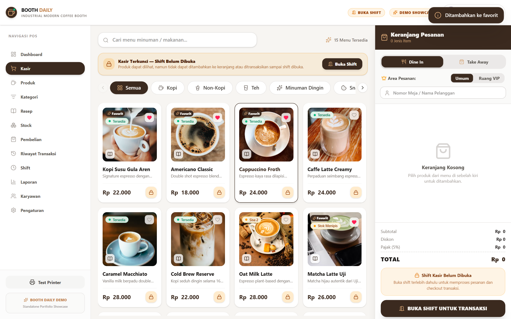
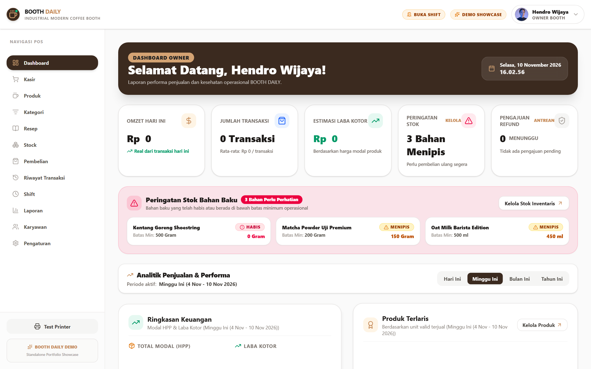
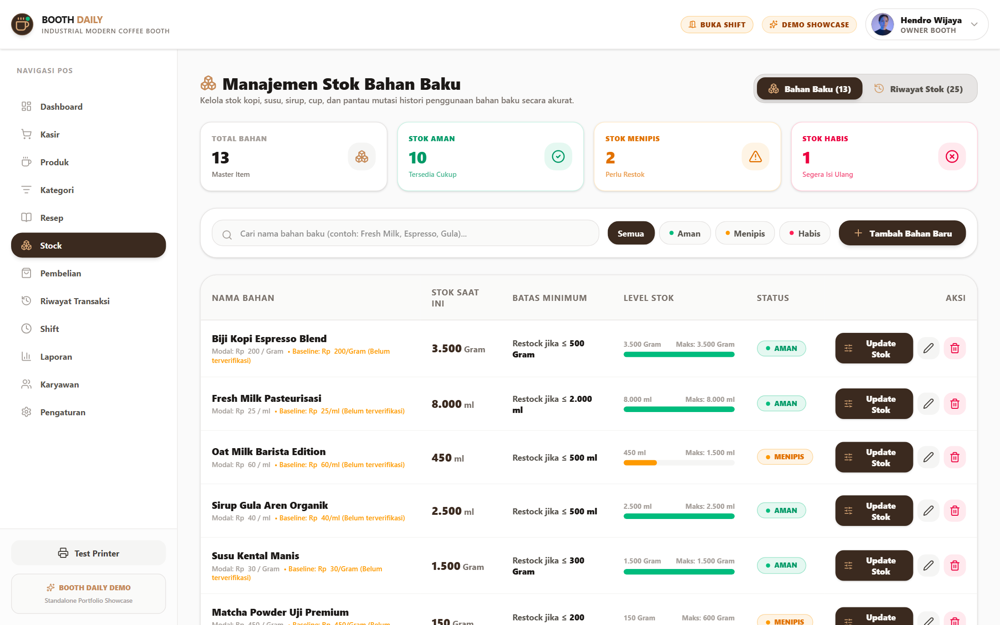
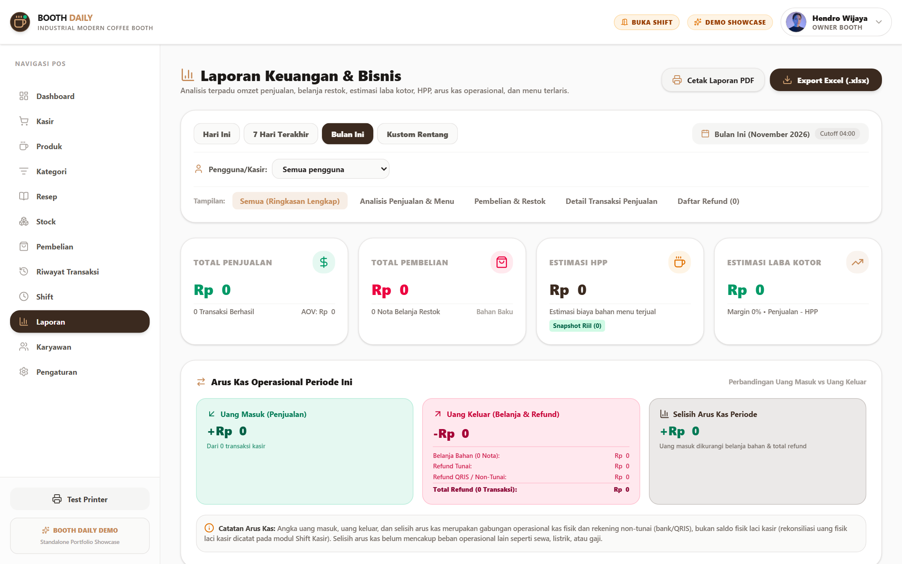
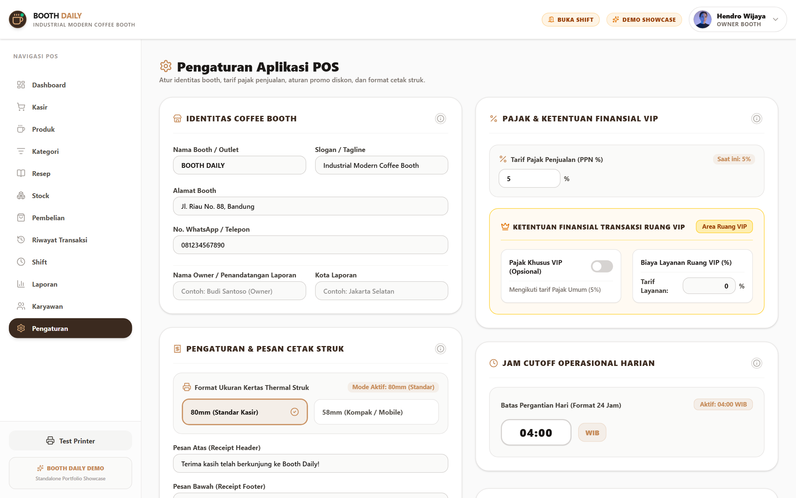

# ☕ Booth Daily — Modern Coffee Shop POS & Management System

[](https://react.dev/)
[](https://www.typescriptlang.org/)
[](https://vitejs.dev/)
[](https://tailwindcss.com/)
[](#architecture--zero-backend-design)

> A modern, responsive **Point of Sale (POS) and Coffee Shop Management System** built as an interactive **Standalone Client-Side Showcase**. Designed to demonstrate modular frontend architecture, reactive client-side state management, domain-driven services, and realistic business workflows directly in the browser—with zero backend server requirements.

---

## Visual Showcase & Previews

Experience the responsive interface and workflows across core operational modules:

### 1. Point of Sale (POS) & Checkout
Fast cashier terminal featuring categorical filtering, live search, custom barista notes, dine-in / take-away switching, and cash / QRIS split payments.


---

### 2. Management Dashboard & Metrics
Daily turnover, gross profit estimates, product sales ranking, and sales trajectory charts.


---

### 3. Recipe-Based Inventory & Stock Tracking
Ingredient level tracking down to grams/milliliters with low-stock alerts and transaction mutation logs.


---

### 4. Financial Analytics & Document Exports
Revenue breakdowns by payment method and order type, with client-side Excel and PDF export pipelines.


---

### 5. Settings, Promotional Rules & Encrypted Backup
Store configurations, tiered promotional rules, receipt templates, and client-side AES-GCM 256-bit encrypted data backup & recovery.


---

## Key Highlights & Capabilities

### Point of Sale (POS) Terminal
- **Intuitive Order Flow:** Category navigation pills, text search, quantity adjustments, and custom barista instructions (*Less Sugar, No Ice, Extra Shot*).
- **Flexible Order Types:** One-click toggle between **Dine In** (table assignment) and **Take Away**.
- **Payment Method Simulation:** 
  - **Cash:** Real-time cash received input, quick denomination buttons, and automatic change calculation.
  - **QRIS:** Simulated cashless transaction validation for exact payment amounts (local prototype simulation, not connected to an external payment gateway).
- **Cashier PIN Authorization:** Simulated 4-digit PIN verification modal allowing guests or cashiers to authorize transactions locally without full account privilege escalation.
- **80mm Thermal Receipt Simulation:** Pixel-perfect receipt rendering in an isolated iframe with browser print trigger and one-click text copying to clipboard.

### Recipe-Based Automated Stock Deduction
- **Ingredient Tracking:** Each beverage and menu item is mapped to a recipe with exact raw ingredient quantities (grams, milliliters, pieces).
- **Automated Deduction:** Placing an order deducts raw stock and records an audit log entry in `Stock History` within the client-side store.
- **Dynamic Stock Guard:** Menus automatically flag items as **Sold Out** or **Low Stock** when recipe ingredients drop below required thresholds.
- **Refund Inventory Reversion:** Refunding an order restores deducted raw ingredients back to inventory with dedicated mutation logs.

### Staff, Shifts & Cash Drawer Reconciliation
- **Shift Lifecycle:** Open shifts with verified beginning cash balance, track operational cash sales vs. cashless QRIS, and close shifts with cash drawer count verification.
- **Petty Cash Disbursements:** Record operational cash outflows with reason and manager PIN authorization.
- **Cash Discrepancy Auditing:** Automatic comparison between expected cash in drawer and actual physical cash submitted.

### Financial Reporting & Document Generation
- **Visual Analytics:** Interactive multi-period sales trend charts (daily, weekly, monthly, annual).
- **Key Retail Metrics:** Gross Revenue, Cost of Goods Sold (COGS / HPP), Net Profit, Average Ticket Size, and Top 5 Best-Selling Products.
- **Client-Side Document Exports:**
  - **Excel (`.xlsx`):** Multi-sheet financial statements powered by SheetJS.
  - **PDF (`.pdf`):** Formatted tabular reports with branded headers powered by jsPDF and AutoTable.
  - *Lazy loaded on-demand to keep initial bundle size lean.*

### Encrypted Local Backup & Data Resilience
- **Client-Side AES-GCM 256-Bit:** Export the entire relational store into an encrypted `.json` snapshot secured with PBKDF2 passphrase key derivation (600,000 iterations).
- **Checksum & Integrity Verification:** Restoring snapshots performs cryptographic decryption, schema structural validation, and reactive store re-hydration.
- **Factory Reset:** Safe, confirmation-gated factory reset to restore default relational seed state at any time.

### Modern Responsive UI / UX
- **Tailwind CSS v4:** Clean warm coffee palette (`Amber`, `Stone`, `Emerald`), consistent typographic scale, and smooth micro-interactions.
- **Dark Mode Support:** Full high-contrast dark theme optimized for low-light cafe counter environments.
- **Responsive Geometry:** Tested across mobile screens (320px, 360px, 375px), tablets (768px, 1024px), and wide desktop displays (1440px+).

---

## Architecture & Zero-Backend Design

Booth Daily Demo operates **entirely in the user's browser** without requiring an external backend API, database server, or cloud subscriptions:

```text
┌─────────────────────────────────────────────────────────────────────────────┐
│                               Presentation Layer                            │
│           React 19 Pages (POS, Dashboard, Inventory, Reports, Settings)     │
│                 Accessible Modals & Dynamic InfoPopovers                    │
└──────────────────────────────────────┬──────────────────────────────────────┘
                                       │
                                       ▼
┌─────────────────────────────────────────────────────────────────────────────┐
│                         State & Facade Layer                                │
│                   POSContext & Custom Domain Hooks                          │
│          (usePOSCart, usePOSOrders, usePOSPayments, usePOSDiscounts)         │
└──────────────────────────────────────┬──────────────────────────────────────┘
                                       │
                                       ▼
┌─────────────────────────────────────────────────────────────────────────────┐
│                           Service Orchestration                             │
│     (orderService, transactionService, stockService, backupService, etc.)   │
│             Atomic recipe calculation, HPP computation, PIN checks          │
└──────────────────────────────────────┬──────────────────────────────────────┘
                                       │
                                       ▼
┌─────────────────────────────────────────────────────────────────────────────┐
│                           Mock Repositories                                 │
│        (orderRepository, productRepository, stockRepository, userRepository)│
└──────────────────────────────────────┬──────────────────────────────────────┘
                                       │
                                       ▼
┌─────────────────────────────────────────────────────────────────────────────┐
│                        Central Reactive Mock Store                          │
│                 Single-source-of-truth in-memory state                      │
│                  Relational queries & transactional updates                 │
└──────────────────────────────────────┬──────────────────────────────────────┘
                                       │
                                       ▼
┌─────────────────────────────────────────────────────────────────────────────┐
│                     Browser LocalStorage Persistence                        │
│                   Key: "boothdaily_demo_store"                              │
└─────────────────────────────────────────────────────────────────────────────┘
```

### Architectural Characteristics:
1. **Instant Local Execution:** All data reads and transactional writes resolve in-memory without network latency.
2. **Simulated Relational Integrity:** Mock repositories simulate relational integrity constraints (foreign key cascades, unique constraints).
3. **Simulated Real-Time Events:** Uses an internal `SafeChannelStub` to simulate multi-window event dispatching without live WebSocket dependencies.
4. **Static Deployment Ready:** The entire application builds into static assets ready for deployment on static hosting platforms.

> ⚠️ **Data Storage Notice:** Application data is persisted in browser LocalStorage under the key `boothdaily_demo_store`. LocalStorage is browser-local and client-managed; it is intended for prototype evaluation and demonstrations, not as a persistent multi-user production database.

---

## Roles & Access Control

The prototype implements role-based route protection and persona management:

### Access Modes & Permissions
- **Guest Mode (Unauthenticated):** Visitors can freely browse the public POS ordering terminal (`/`) and view recipes (`/recipes`). Guests can construct orders, customize drinks, and trigger the checkout flow. However, finalizing transactions requires a staff PIN, and administrative views (Dashboard, Inventory, Shifts, Reports, Settings) are strictly protected. Guest users do not have Owner or management privileges.
- **Staff / Cashier Personas:** Access to POS cashiering, shift opening and closing, cash drawer reconciliation, transaction history, and inventory status.
- **Owner Persona:** Unrestricted access across all operational and administrative screens, including Store Settings, promotional discount rules, financial reports, employee management, and encrypted backup/restore.

| Role | Persona | Permissions Scope |
| :--- | :--- | :--- |
| 👑 **Owner** | Store Owner Persona | Unrestricted administrative access (Settings, Reports, Staff Management, Financials, Inventory, Backup & Restore) |
| ☕ **Staff / Cashier** | Cashier Persona 1 | Front-of-house operations (POS cashiering, order history, inventory status, shift management) |
| ☕ **Staff / Cashier** | Cashier Persona 2 | Front-of-house operations (POS cashiering, order history, inventory status, shift management) |

> 💡 **Accessing Demo Accounts:**
> Visitors can conveniently populate credentials for any role by clicking the built-in **"Akun Demo"** helper button on the login screen, which auto-fills credentials for the selected persona without manual typing. This is an interactive convenience feature for quick evaluation, not a security mechanism.
>
> *Note on Authentication:* User authentication and staff PIN checks are simulated locally within the client-side mock store. Passwords are stored in plain text for demonstration convenience and are not cryptographically hashed.

---

## Relational Mock Dataset

The initial bootstrap seed provides a specialty coffee shop dataset:

- **Users:** 3 accounts (1 Owner, 2 Cashiers) with pre-configured authentication profiles and transaction PINs.
- **Categories:** 6 product categories (Signature Coffee, Classic Espresso, Manual Brew, Tea & Beverages, Pastries, Main Course).
- **Products:** 15 handcrafted items with cost prices, selling prices, categories, and recipe links.
- **Raw Ingredients (Stocks):** 13 tracked inventory items (Coffee Beans, Fresh Milk, Oat Milk, Vanilla Syrup, Caramel Sauce, Cups, Straws, etc.).
- **Standard Recipes:** 15 ingredient bill-of-materials per item.
- **Historical Orders:** 50 pre-populated transactions spanning the past 30 days for rich analytics visualization.
- **Purchase Orders:** 7 historical supplier ingredient restock invoices.
- **Stock Audit Logs:** 25 historical stock adjustment and mutation records.
- **Promotional Rules:** 3 tiered discount rules (e.g., Happy Hour, Weekend Specials, Volume Discounts).
- **Store Configuration:** Store identity, tax rate (5%), and receipt footer notes.

---

## Getting Started

### Prerequisites
- **Node.js:** `>= 20.19.0` or `>= 22.12.0` (LTS recommended)
- **Package Manager:** `npm` (`v9.x`+) or `pnpm`

### Installation

1. **Clone the Repository:**
   ```bash
   git clone <repository-url>
   cd Booth-Daily-demo
   ```

2. **Install Dependencies:**
   ```bash
   npm install
   ```

3. **Start Development Server:**
   ```bash
   npm run dev
   ```
   Open your browser and navigate to `http://localhost:3000` (configured via `--port=3000 --host=0.0.0.0`).

---

## Production Build & Deployment

### Compile Static Build:
```bash
npm run build
```
Optimized static bundles are written to `dist/`. The main entry JavaScript chunk is ~126 kB gzipped (~469 kB uncompressed, plus ~18 kB gzipped CSS). Additional lazy-loaded chunks (individual pages and document export engines like SheetJS and jsPDF) are dynamically fetched on demand, keeping initial page load fast.

### Local Preview of Production Build:
```bash
npm run preview
```

### Static Hosting Deployments:
- **Vercel:** Includes pre-configured `vercel.json` with SPA catch-all rewrites (`"source": "/:path*", "destination": "/index.html"`).
- **Netlify:** Set build command to `npm run build` and publish directory to `dist`.
- **GitHub Pages / Cloudflare Pages:** Ensure routing redirects unmapped routes to `/index.html`.

---

## Validation & Automated Testing

The repository includes automated validation scripts to verify data integrity, mathematical calculations, and user flows:

```bash
# 1. Foundation Mock Integrity & Relational Verification
npm run validate:mock

# 2. Service Layer Adapters & Repositories Validation
npm run validate:phase2

# 3. Checkout Flow, Recipe Stock Deductions & Order Creation
npm run validate:phase3

# 4. Full CRUD Operations, Staff Roles & Refund Restorations
npm run validate:phase4

# 5. Standalone Integration, Guest Checkout & Security Checks
npm run validate:phase5

# 6. Static TypeScript Type Checking (tsc --noEmit)
npm run lint

# 7. Production Build Verification
npm run build
```

---

## Resetting Demo Data

To return the application to its clean factory seed state at any time:
1. Navigate to **Pengaturan (Settings)** as an Owner and click **"Muat Ulang Seluruh Data Toko (Factory Reset)"**. This cleanly reinstates the initial relational seed dataset.

> 🛠️ **Troubleshooting State:** If browser storage state ever becomes corrupted during testing, clearing the browser LocalStorage key `boothdaily_demo_store` in Developer Tools and refreshing the page will also trigger fresh seed initialization.

---

## Project Structure

```text
Booth-Daily-demo/
├── docs/
│   ├── HISTORICAL_AUDIT_SUMMARY.md # Consolidated engineering logs and audit history
│   └── screenshots/              # High-DPI application showcase screenshots
│       ├── dashboard.png
│       ├── inventory.png
│       ├── pos.png
│       ├── reports.png
│       └── settings.png
├── src/
│   ├── assets/                   # App logos and iconography
│   ├── components/               # Reusable UI components & modals
│   │   ├── common/               # ConfirmDialog, NumberInput, PINModal, ReceiptModal
│   │   ├── layout/               # Header, Sidebar, MobileMenu, BottomNav
│   │   ├── pos/                  # ProductCard, CartSidebar, CategoryBar, CloseShiftModal
│   │   ├── settings/             # DiscountRuleModal, BackupModal, RestoreModal
│   │   └── transactions/         # TransactionDetailModal, RefundModal
│   ├── context/                  # React Context & domain hook facades (POSContext)
│   ├── layouts/                  # MainLayout with responsive navigation shell
│   ├── mock/                     # Standalone mock infrastructure
│   │   ├── data/                 # Seed data (products, recipes, orders, stocks, users)
│   │   ├── persistence/          # LocalStorage persistence layer
│   │   ├── repositories/         # Relational query & mutation repositories
│   │   ├── store.ts              # Central reactive store
│   │   └── validation/           # Automated validation test scripts
│   ├── pages/                    # Route entry points (POS, Dashboard, Inventory, etc.)
│   ├── services/                 # Business logic services (order, stock, backup, export)
│   ├── types/                    # Shared TypeScript interfaces & domain types
│   ├── utils/                    # Math helpers, receipt formatters, shift calculations
│   ├── App.tsx                   # Main router configuration & route guards
│   └── main.tsx                  # Application entry point
├── package.json
├── tsconfig.json
├── vercel.json
├── vite.config.ts
└── README.md
```

---

## About This Project

This project was developed as a frontend engineering portfolio demonstration to showcase complex state orchestration, point-of-sale operational logic, and responsive UI design in a standalone client-side environment.
